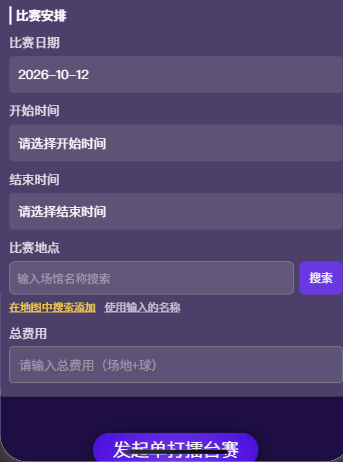

# 选时盘 daydial · 微信小程序预约选时（一个弹窗选完日期 + 时间）

> `daydial` = **day**（月历选日）+ **dial**（表盘选时）；中文名「选时盘」。

面向**约赛 / 订场 / 活动报名 / 预约到店**场景的底部弹出日期时间组件：

- **一个弹窗同时拿到日期 + 时间**：表头左边日期、右边时间，点哪边切哪边，一次 ✓ 返回 `YYYY-MM-DD HH:mm`——不跳页、不弹第二次、切换时不丢已选值
- **底部「✕ / ✓」两个按钮**：放弃有明确出口，不用猜"点遮罩能关"；符号本身跨语言、不用翻译，想要文字再传 `cancel-text="取消" confirm-text="确定"`
- 月历选日期（支持最小/最大日期）
- 24 小时双圈表盘选时间（分钟步进可配）
- 界面以数字与符号为主，几乎无文案，易嵌入多语言项目
- 零云函数依赖，复制即可用

> 本仓库是可运行的演示小程序 + 可拆走的组件。组件免费开源（MIT）；若需要整站预约/运动小程序搭建或定制，见文末「合作与定制」。



| 月历选日 | 表盘选时 | 仅日期 | 仅时间 |
|---|---|---|---|
|  |  |  |  |

> 上面两张图是**同一个弹窗**的两个状态：表头始终并排显示已选日期与时间，点左侧回月历、点右侧切表盘，底部只有一个 ✓。
> 不用「先选日期 → 关掉 → 再开时间」两个弹层，切换也不会丢掉另一半已选的值。

主题色一个属性即可切换：

| 蓝 | 绿 | 橙 | 红 |
|---|---|---|---|
|  |  |  |  |

## 为什么不用原生 picker

| | 原生 `picker` | 本组件 |
|---|---|---|
| **一次选「日期 + 时间」** | 两个 `picker` 串联：弹两次、确认两次；或 `multiSelector` 五列滚轮 | **同一个弹窗**内切换，表头常驻两个值，一次 ✓ 拿到完整结果 |
| 日期 | 滚轮，难一眼看整月 | 月历，适合约赛/订场 |
| 时间 | 滚轮 | 表盘，更接近「选钟点」习惯 |
| 范围限制 | 有，但体验一般 | `min-date` / `max-date` 灰显不可点 |
| 多语言 | 跟系统 | 默认无长文案；星期可用 `weekdays` 传入 |

## 快速预览

1. 用[微信开发者工具](https://developers.weixin.qq.com/miniprogram/dev/devtools/download.html)打开本仓库根目录  
2. AppID 可先用测试号  
3. 编译后打开「预约选时演示」页，分别试：日期时间 / 仅日期 / 仅时间  
## 嵌入你的项目（约 1 分钟）

### 方式一：npm 安装（推荐）

1. 在小程序项目根目录（`package.json` 所在处）安装：

```bash
npm install daydial
```

2. 微信开发者工具菜单「工具 → 构建 npm」

   若 `package.json` 在项目根目录、小程序代码在 `miniprogram/` 子目录，需在 `project.config.json` 的 `setting` 中配置：

   ```json
   "packNpmManually": true,
   "packNpmRelationList": [
     { "packageJsonPath": "./package.json", "miniprogramNpmDistDir": "./miniprogram/" }
   ]
   ```

3. 页面 `json` 注册：

```json
{
  "usingComponents": {
    "datetime-sheet": "daydial/index"
  }
}
```

### 方式二：复制源码

1. 复制 `miniprogram/components/datetime-sheet/` → 你的小程序 `components/datetime-sheet/`
2. 页面 `json` 注册：

```json
{
  "usingComponents": {
    "datetime-sheet": "/components/datetime-sheet/index"
  }
}
```

### 页面使用（两种方式相同）

```html
<datetime-sheet
  show="{{dtShow}}"
  mode="datetime"
  date-value="{{date}}"
  time-value="{{time}}"
  min-date="{{minDate}}"
  step-minutes="{{5}}"
  cancel-text="取消"
  confirm-text="确定"
  bind:confirm="onDtConfirm"
  bind:close="onDtClose"
/>
```

```js
onDtConfirm(e) {
  // e.detail = { date: 'YYYY-MM-DD', time: 'HH:mm', datetime: 'YYYY-MM-DD HH:mm' }
  this.setData({
    date: e.detail.date,
    time: e.detail.time,
    dtShow: false
  });
},
onDtClose() {
  this.setData({ dtShow: false });
}
```

组件不会自己关闭，请在 `confirm` / `close` 后把 `show` 设为 `false`。

## 属性

| 属性 | 类型 | 默认 | 说明 |
|---|---|---|---|
| show | Boolean | false | 是否显示 |
| mode | String | `datetime` | `datetime` / `date` / `time` |
| date-value | String | 今天 | `YYYY-MM-DD` |
| time-value | String | `19:00` | `HH:mm` |
| min-date / max-date | String | 空 | 可选范围 |
| step-minutes | Number | 5 | 分钟刻度 |
| week-start | Number | 1 | `0`=周日，`1`=周一 |
| weekdays | Array | 日一二三四五六 | 7 项，从周日开始 |
| theme-color | String | 空（`#6B37E5`） | 主色：选中日期/小时、表针、✓ 按钮底色、✕ 按钮文字 |
| theme-color-soft | String | 空（`#f4f1fa`） | 表盘圆形底色、✕ 按钮底色 |
| cancel-text | String | `✕` | 取消按钮内容；符号跨语言，传 `取消` 可换成文字 |
| confirm-text | String | `✓` | 确认按钮内容；传 `确定` 可换成文字 |

## 事件

- `confirm`：`{ date, time, datetime }`
- `close` / `cancel`：关闭面板（点「✕」或点遮罩都会触发这两个事件）

取消不返回数据，也不会修改外部值；下次 `show` 为 `true` 时组件会用 `date-value` / `time-value` 重新初始化，所以用户放弃后不会看到上次的临时选择。

## 主题色

两种方式，任选其一，无需改组件源码。

方式一：属性传入（单个页面换色）

```xml
<datetime-sheet theme-color="#1677FF" theme-color-soft="#EAF2FF" ... />
```

方式二：CSS 变量（全局统一换色，写在 `app.wxss` 的 `page` 上）

```css
page {
  --dt-primary: #1677FF;
  --dt-primary-soft: #EAF2FF;
  --dt-sunday: #e24b4b;
}
```

| 变量 | 默认值 | 用途 |
|------|--------|------|
| `--dt-primary` | `#6B37E5` | 主色（含确认按钮，纯色） |
| `--dt-primary-soft` | `#f4f1fa` | 表盘圆形底色 |
| `--dt-sunday` | `#e24b4b` | 周日列文字色 |

属性优先于全局变量；都不设置时使用默认紫色。

## 适用场景

- 网球 / 羽毛球约赛、擂台赛选时  
- 场馆订场、课程预约  
- 活动接龙、报名截止时间  
- 到店预约、面诊排期  

组件本身免费；完整「预约 + 支付 + 管理后台」属于定制开发范围。

## 合作与定制

如果你需要：

- 运动约赛 / 场馆订场 / 活动报名小程序整包  
- 把本组件接入现有项目并统一主题  
- 云开发（云函数 + 数据库）预约与通知  

欢迎联系（请注明场景与城市）：

- 邮箱：`deserteagle369@163.com`  
- （可选）在 Issue 里留言，看到会回复  

## 目录结构

```text
daydial/
├── miniprogram/
│   ├── components/datetime-sheet/   # 可单独复制走的组件
│   └── pages/demo/                  # 演示页
├── docs/
│   └── screenshots/                 # 截图 / GIF
├── project.config.json
├── LICENSE                          # MIT
└── README.md
```

## 使用与署名

本组件以 MIT 发布，**不强制署名、商用无需授权或付费**。但如果它帮你省了时间，欢迎留一行出处——这是我继续维护的主要动力：

```md
日期时间选择器：[daydial](https://github.com/deserteagle369/daydial)（MIT）
```

按成本从低到高，挑一个放：

| 位置 | 做法 | 谁能看到 |
|---|---|---|
| 代码注释 | 保留 `components/datetime-sheet/index.js` 顶部的版权注释（MIT 本来也要求保留） | 只有你的开发者 |
| 项目 README | 上面那行放进「致谢 / 开源组件」小节 | 看仓库的人 |
| 小程序内 | 「关于」页或设置页加一行链接 | 你的所有用户 |

需要把组件接入整包项目、统一主题或加预约支付后台，见下方「合作与定制」。

## 许可

[MIT](./LICENSE)。可商用、可修改；上线前请自行完成小程序合规与备案要求。
